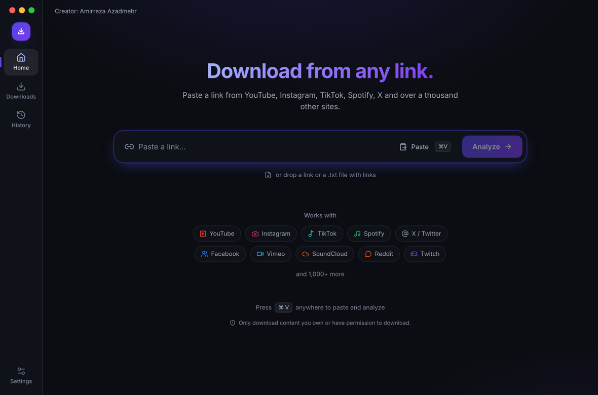
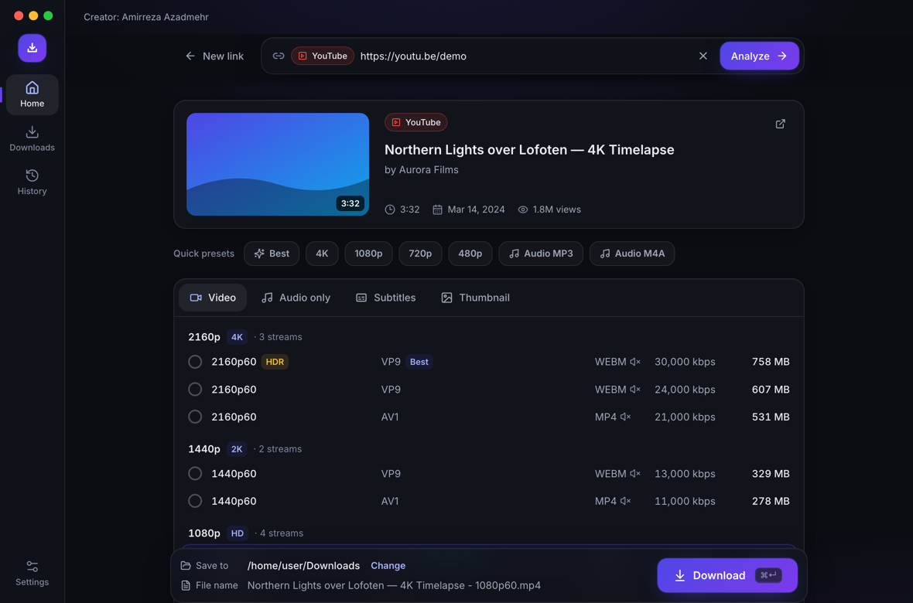
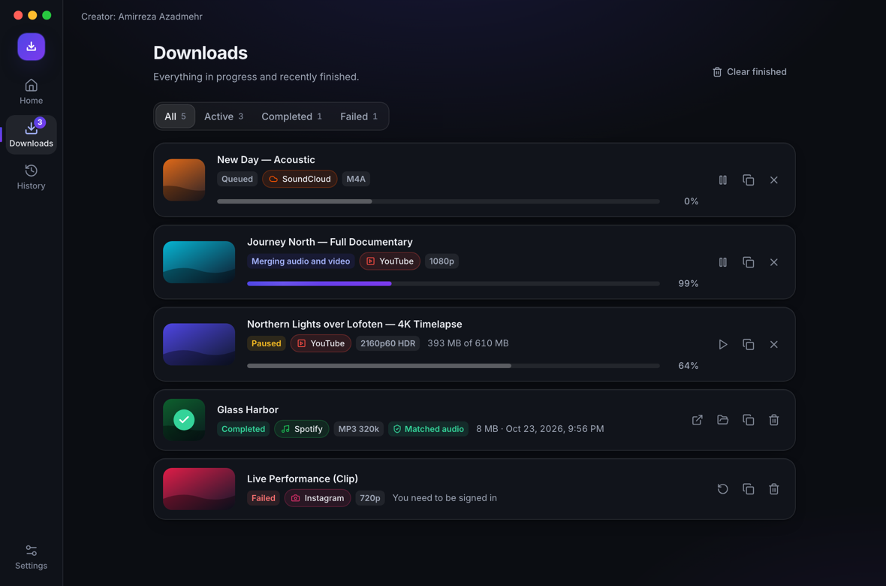

# Dlyven

  

  

  

贴个链接，选画质，下载。就这么简单。

桌面端，开源，Windows / macOS / Linux。底层是 [yt-dlp](https://github.com/yt-dlp/yt-dlp) + ffmpeg —— Dlyven 就是套了个好看点的窗口。

**网站:** [amirreza-azadmehr.github.io/dlyven](https://amirreza-azadmehr.github.io/dlyven/) · **[给开发者的 README](../../README.md)**

**语言:** [English](README.en.md) · [فارسی](README.fa.md) · [Español](README.es.md) · [Français](README.fr.md) · [Türkçe](README.tr.md) · [العربية](README.ar.md) · [Русский](README.ru.md) · [简体中文](README.zh-CN.md) · [Deutsch](README.de.md) · [Português (Brasil)](README.pt-BR.md) · [کوردی](README.ckb.md)

  
  &nbsp;&nbsp;
  
  &nbsp;&nbsp;
  
  &nbsp;&nbsp;
  
  &nbsp;&nbsp;
  
  &nbsp;&nbsp;
  
  &nbsp;&nbsp;
  
  &nbsp;&nbsp;
  

这些 logo 不是我们的。YouTube、Instagram、TikTok、Spotify 都是人家的 —— 我们只是个下载器。

> 只下你自己的，或者你有权下的东西。

## 安装

1. 打开[最新版本](https://github.com/amirreza-azadmehr/dlyven/releases/latest)。
2. 只下一**个**文件：

| 你的电脑 | 文件 |
| --- | --- |
| Windows | `Dlyven-windows-amd64.exe` |
| Mac（Intel 或 Apple 芯片） | `Dlyven-macos-universal.zip` |
| Linux x64 | `Dlyven-linux-amd64` |
| Linux ARM | `Dlyven-linux-arm64` |

3. 打开。Windows：双击 `.exe`。Linux：先 `chmod +x Dlyven-linux-*` 再运行。Mac：解压后打开 `Dlyven.app`。
4. 第一次需要联网 —— 它自己去拉 yt-dlp 和 ffmpeg。之后贴个链接就能下。

不用安装器。官方构建在配好 Apple / Windows 证书后会签名。自己编译？[给开发者的 README](../../README.md)。

## 怎么用

1. 贴链接（或者 <kbd>Ctrl/⌘ V</kbd>，或者把 URL / 一堆链接的 `.txt` 拖进去）。
2. 等一下 —— 标题、封面、能找到的所有画质。
3. 视频、音频、字幕或封面。懒得选就用预设。
4. 选文件夹，下载。队列里可以暂停 / 继续 / 取消。

私密内容：设置 → 登录和 Cookie。网络受限：设置 → 网络。

## 支持的网站

YouTube、Instagram、TikTok、Spotify、X、Facebook、Vimeo、SoundCloud、Reddit、Twitch……还有 [whatever else yt-dlp knows](https://github.com/yt-dlp/yt-dlp/blob/master/supportedsites.md)。不认识的链接也能下，会显示成「其他网站」。

**YouTube** —— 贴链接，视频或 MP3，下载。播放列表有勾选。

**Instagram** —— Reel 或帖子链接。私密的需要登录（Cookie）。

**TikTok** —— 贴上，视频或音频。短链也行。

**Spotify** —— 不从 Spotify 扒音频。读公开的歌名/歌手，找一条公开的录音，打上标签。没有播客。

## 常见问题

**官方 YouTube / Instagram / TikTok 应用？** 不是。就是 yt-dlp 套了个桌面壳。

**能直接从 Spotify 下歌？** 不行。只匹配一条公开录音。

**会偷偷上报吗？** 不会。

**文件在哪？** Windows `%AppData%\Dlyven` · Mac `~/Library/Application Support/Dlyven` · Linux `~/.config/Dlyven`.

## 参与

[CONTRIBUTING.md](../../CONTRIBUTING.md) · [CODE_OF_CONDUCT.md](../../CODE_OF_CONDUCT.md) · [SECURITY.md](../../SECURITY.md)

## 许可

[GPL-3.0](../../LICENSE) © 2026 Amirreza Azadmehr。[第三方说明](../../THIRD_PARTY_NOTICES.md)。

作者：[GitHub](https://github.com/amirreza-azadmehr) · [LinkedIn](https://tr.linkedin.com/in/amirreza-azadmehr) · [Telegram](https://t.me/amir_reza_azadmehr)

